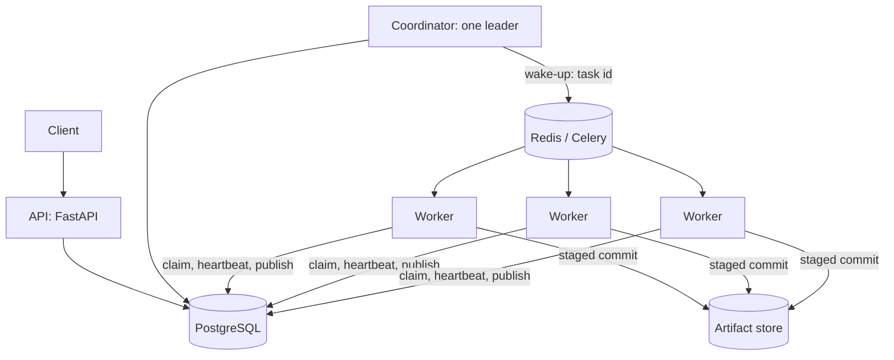

# QuantGrid

[](https://github.com/Ankur17nith/quantgrid/actions/workflows/ci.yml)
[](LICENSE)
[](pyproject.toml)

A fault-tolerant scheduler for large batches of reproducible backtests.

You submit a parameter grid. QuantGrid expands it into immutable tasks, runs them on a pool of worker processes, and survives workers being killed or frozen mid-task. Afterwards it can prove that every expected task has exactly one published result. An optional AI planner proposes experiment specs; all limits, state and numbers come from deterministic code.

It runs offline on synthetic data. It has no broker connectivity and places no orders.

- **At-least-once execution, at-most-once publication.** A task can run twice; its result is published once. Exactly-once execution is not claimed ([how, and the tests](docs/correctness.md)).
- **PostgreSQL is the source of truth.** Redis and Celery only carry "task X may be claimable" messages, so a lost or duplicated message is harmless.
- **Reproducible.** Specs are hashed, datasets are checksummed, results are byte-identical for identical specs, and each batch records the exact code and dependencies.

| In numbers | Value | Source |
| --- | --- | --- |
| Speedup on 4 workers, 32 long + 64 short CPU-bound tasks | 3.28x (82% efficiency); 2 workers 1.81x (90.5%) | [benchmarks/results/20261121T165311Z/REPORT.md](benchmarks/results/20261121T165311Z/REPORT.md), `make bench` |
| Makespan, 1 / 2 / 4 workers | 19.1 s / 10.5 s / 5.8 s | same |
| Efficiency at 4 workers by batch size (4, 8, 16, 32, 64 tasks) | 72%, 68%, 73%, 75%, 83% | same |
| Time from a worker's SIGKILL to the task being re-published (15 s lease) | 15.4 s | [benchmarks/results/chaos-kill-20261121T165157Z.json](benchmarks/results/chaos-kill-20261121T165157Z.json), `make chaos` |
| Same, worker frozen with SIGSTOP for 30 s then resumed | 15.4 s, and the resumed worker published nothing | [benchmarks/results/chaos-stop-20261121T165225Z.json](benchmarks/results/chaos-stop-20261121T165225Z.json) |
| Results after each chaos run | 144 of 144 tasks, 1 retry, verifier passed | same two files |
| Automated tests, all passing | 914 | `make test`, run 21 November 2026 |

Measured on one 4 vCPU Intel Xeon 2.1 GHz virtual machine that also hosted PostgreSQL, Redis, the coordinator and the benchmark driver. Efficiency drops as workers approach the core count because they share the machine with those. An earlier run on the same machine measured 3.60x at 4 workers, so expect 3.3 to 3.6x here. The full method and caveats are in each report.

## Quick start

Needs Python 3.12, [uv](https://docs.astral.sh/uv/), and PostgreSQL 16 and Redis 7 (or Docker).

```sh
make install
make services            # PostgreSQL on 5433 and Redis on 6380, no Docker
eval "$(scripts/dev_services.sh env)"
make migrate
make demo                # 144 tasks, 4 workers, kills one mid-run, verifies the result
```

`make demo` starts the coordinator, the API and four workers, submits a batch over HTTP, kills a worker with `SIGKILL`, waits for recovery and runs the verifier. Its output goes to `var/demo/transcript.txt`.

To run the pieces yourself:

```sh
quantgrid coordinator
quantgrid api --port 8000
quantgrid worker --worker-id w1        # one per CPU core
```

With Docker: `docker compose up --build --scale worker=4`. The API is on `127.0.0.1:8000` with the development key `dev-key`.

## Using it

```sh
curl -X POST localhost:8000/v1/batches \
  -H 'X-API-Key: dev-key' -H 'Idempotency-Key: run-1' -H 'Content-Type: application/json' -d '{
    "name": "sweep",
    "dataset": {"name": "pairs-ou-small-v1", "sha256": "<from GET /v1/datasets>"},
    "strategy": {"name": "pairs_zscore", "version": "1"},
    "grid": {"lookback": [20, 40, 80], "entry_z": [1.5, 2.0, 2.5], "exit_z": [0.0, 0.5]},
    "seeds": [7, 11]
  }'
```

```json
{"batch_id": "<uuid>", "state": "ACCEPTED", "task_count": 36, "idempotent_replay": false,
 "estimate": {"task_count": 36, "est_seconds_per_task": 0.054, "est_total_worker_seconds": 1.944,
              "est_memory_mb_per_task": 160.5, "n_train_bars_est": 1200, "n_test_bars_est": 800}}
```

Sending the same request with the same `Idempotency-Key` returns the same batch. Then:

| Request | Result |
| --- | --- |
| `GET /v1/batches/{id}` | State, per-state task counts, attempts, cost in worker-seconds |
| `GET /v1/tasks/{id}` | Attempt log with workers and errors, artifact, audited state transitions |
| `GET /v1/batches/{id}/results` | Metrics per task plus the reproducibility manifest |
| `POST /v1/batches/{id}/cancel` | Stops waiting and running tasks, reports what already completed |
| `POST /v1/batches/{id}/retry-failed` | Retries eligible failures within quota |
| `POST /v1/planner/specs` | AI proposes a validated spec; nothing is stored or run |

Full reference: [docs/api.md](docs/api.md). To check a finished batch:

```sh
quantgrid verify <batch-id>                 # exits 1 on any failed check
quantgrid verify <batch-id> --recompute 5   # also re-run 5 tasks and compare bytes
```

## How it works



1. The API validates the spec, applies the quota policy, expands the grid into tasks keyed by a content hash, and stores the batch and every task in one transaction.
2. The coordinator keeps a bounded window of wake-up messages in flight.
3. A worker claims a task with a conditional update that sets a lease and bumps the attempt counter, runs the deterministic engine, writes the result to a content-addressed Parquet file (temp file, fsync, atomic rename), and publishes in one transaction.
4. Workers extend their leases from a heartbeat thread. If a worker dies or freezes, the coordinator reclaims the expired lease and the task is retried. A worker that comes back after losing its lease cannot publish, because publishing re-checks the lease owner and attempt number under a row lock.
5. Database triggers enforce the state machine, make specs and results immutable, and log every transition.

More in [docs/architecture.md](docs/architecture.md) and the [decision records](docs/adr).

## Commands

| Command | What it does |
| --- | --- |
| `make install` | Install dependencies from `uv.lock` |
| `make services` | Start PostgreSQL and Redis natively |
| `make migrate` | Apply Alembic migrations |
| `make test` | Unit, property, integration and end-to-end tests |
| `make test-fast` | Tests that need no PostgreSQL or Redis |
| `make check` | `ruff check`, `ruff format --check`, `mypy --strict` |
| `make demo` | End-to-end demo with a worker kill |
| `make chaos` | SIGKILL and SIGSTOP failure runs with verification |
| `make bench` | Scaling benchmark for 1, 2 and 4 workers |

## Tests and checks

```sh
make check && make test
```

- **Unit and property tests** cover specs, hashing, the state machines, policy, the result codec, the artifact store and the engine. Hypothesis tests compare the engine with an independent slow pure-Python reference on random data and parameters.
- **Integration tests** run against a real PostgreSQL: concurrent claims, fencing of a stalled worker, cancel against publish, idempotent submission, trigger enforcement, and the HTTP API.
- **End-to-end tests** start real coordinator and worker processes and deliver real `SIGKILL` and `SIGSTOP`, then run the verifier.
- **Adversarial tests** feed the AI agent injected instructions, bad tool arguments, unknown tools and slow providers, and check that policy still rejects the result and nothing is stored.
- The verifier checks, after every failure scenario: spec integrity, expected task set, one result per succeeded task, artifact checksums and contents, an independent DuckDB scan, the attempt log, every audited transition, and that no retry produced different bytes.

`.github/workflows/ci.yml` runs lint, types, migrations up and down, and the full suite against PostgreSQL 16 and Redis 7 on every push, and builds the image.

## AI planner

`POST /v1/planner/specs` turns a goal into an experiment spec. The default provider is a deterministic local one that needs no key. A Claude provider is available by setting `QG_LLM_PROVIDER=anthropic` and `ANTHROPIC_API_KEY` (install the `llm` extra); the prompts and tool results then go to the Anthropic API.

The agent has seven read-only tools and no tool that submits, cancels, deletes, runs code or touches files. Its answer must parse as a strict spec and pass the same policy the API applies to a human request. The explainer endpoint reads batch progress through a read-only interface.

## Configuration

Environment variables prefixed `QG_`, listed with defaults in [.env.example](.env.example) and explained in [docs/operations.md](docs/operations.md), which also covers metrics, logs, shutdown, upgrades and troubleshooting. The lease TTL (`QG_LEASE_TTL_S`, default 15 s) sets how fast a dead worker's task is retried.

## Limitations

- Results on the synthetic datasets say nothing about profitability. The data is generated with a known mean-reverting structure, and `pairs-rw-control-v1` is the negative control.
- One strategy is built in. Costs are linear, with no market impact, borrow cost or latency. No multiple-testing correction is applied across a grid.
- A worker stuck in native code cannot be interrupted; its task is reclaimed after the lease expires but the process keeps running until killed.
- Authentication is static API keys over plain HTTP. The artifact store is a local filesystem. PostgreSQL and Redis are single instances.
- Bitwise reproducibility holds for the same code, dependencies and CPU architecture.
- The Compose stack and image have not been published as a release, and CI has not run on GitHub yet.

The full list is in [docs/limitations.md](docs/limitations.md), and planned work is in [ROADMAP.md](ROADMAP.md).

## Documentation

| Document | Contents |
| --- | --- |
| [docs/architecture.md](docs/architecture.md) | Components, lifecycle, failure handling, data model |
| [docs/api.md](docs/api.md) | Every endpoint, error type and convention |
| [docs/operations.md](docs/operations.md) | Running, configuring, monitoring, upgrading |
| [docs/correctness.md](docs/correctness.md) | Invariants, the test for each, bugs found |
| [docs/strategy.md](docs/strategy.md) | Exact definition of the strategy, metrics and bootstrap |
| [docs/datasets.md](docs/datasets.md) | How the synthetic datasets are generated and checksummed |
| [docs/limitations.md](docs/limitations.md) | Modelling and system limits |
| [docs/adr](docs/adr) | Design decisions |
| [SECURITY.md](SECURITY.md), [CONTRIBUTING.md](CONTRIBUTING.md), [CHANGELOG.md](CHANGELOG.md), [ROADMAP.md](ROADMAP.md) | |

## Layout

```
src/quantgrid/   domain/ (engine, specs, policy)  storage/  api/  workers/  coordinator/
                 agents/  observability/  results/ (codec, verifier, export)  cli.py
migrations/  tests/{unit,property,integration,adversarial}  scripts/  docs/  benchmarks/results/
```

## License

[MIT](LICENSE).
