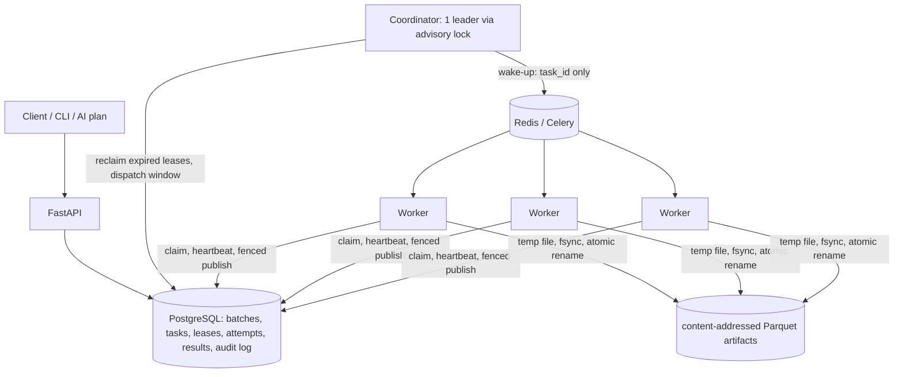

# QuantGrid: fault-tolerant scheduler for reproducible backtests

Runs large parameter sweeps of backtests across bounded worker processes, survives workers
being killed mid-task, and proves afterwards that every expected task has **exactly one**
published result. An optional AI planner proposes typed experiment specs; deterministic code
decides everything else.

> Offline research on **synthetic data**. No live trading, no broker credentials, no profitability
> claims. See [docs/LIMITATIONS.md](docs/LIMITATIONS.md).

Execution is **at-least-once**; the *effect* (one published result per task) is at-most-once.
We do not claim exactly-once execution ([docs/CORRECTNESS.md](docs/CORRECTNESS.md)).

## Architecture



* **PostgreSQL is the source of truth**; Celery messages are wake-up tokens, so a lost or
  duplicated message is harmless ([ADR 0001](docs/adr/0001-postgres-source-of-truth.md)).
* **Leases + fencing token** `(lease_owner, attempts)`: a frozen "zombie" worker that resumes cannot
  publish ([ADR 0002](docs/adr/0002-leases-fencing-at-least-once.md)).
* **Database triggers** enforce the state machine and log every transition
  ([ADR 0004](docs/adr/0004-database-enforced-state-machine.md)).
* All eight ADRs are in [docs/adr](docs/adr).

## Run it

Prerequisites: Python 3.12, [uv](https://docs.astral.sh/uv/), PostgreSQL 16 and Redis 7 binaries
(or Docker).

```bash
uv sync --all-extras
scripts/dev_services.sh start && eval "$(scripts/dev_services.sh env)"   # native PG + Redis, no Docker
.venv/bin/alembic upgrade head
cp .env.example .env   # optional; defaults work locally
```

```bash
# four terminals (or see scripts/demo.sh, which does all of this)
.venv/bin/quantgrid coordinator
.venv/bin/quantgrid api --port 8000
.venv/bin/quantgrid worker --worker-id w1     # repeat with w2, w3, w4
```

Docker instead: `docker compose up --build --scale worker=4` (see the note under *Status*).

### One-command demo

```bash
scripts/demo.sh    # 144 tasks, 4 workers, SIGKILL one, recovery, verifier. Output: var/demo/transcript.txt
```

### API example (real response from the demo)

```bash
curl -s -X POST localhost:8000/v1/batches -H 'X-API-Key: dev-key' \
  -H 'Idempotency-Key: my-run-1' -H 'Content-Type: application/json' -d @batch.json
# HTTP/1.1 202 Accepted
# {"batch_id": "198a5f33-...", "state": "ACCEPTED", "task_count": 144, "idempotent_replay": false,
#  "estimate": {"est_total_worker_seconds": 14.688, "n_test_bars_est": 800, ...}, "links": {...}}
```

| Method | Path | Behaviour |
|---|---|---|
| POST | `/v1/batches` | submit a bounded batch; `Idempotency-Key` required; `202` |
| GET | `/v1/batches/{id}` | progress counts, cost (worker-seconds), manifest ids |
| GET | `/v1/tasks/{id}` | attempt log, worker ids, artifact, audited transitions |
| POST | `/v1/batches/{id}/cancel` | cooperative; reports tasks already completed |
| POST | `/v1/batches/{id}/retry-failed` | retry eligible failures within quota |
| GET | `/v1/batches/{id}/results` | merged metrics + reproducibility manifest |
| POST | `/v1/planner/specs` | AI proposes a validated spec (never enqueues) |
| POST | `/v1/batches/{id}/explain` | read-only AI diagnosis |
| GET | `/healthz` `/readyz` `/metrics` | liveness, readiness, Prometheus |

Errors use `{"error": {"type": ..., "message": ..., "request_id": ...}}` with types
`VALIDATION_ERROR`, `NOT_FOUND`, `RATE_LIMITED`, `QUOTA_EXCEEDED`, `CONFLICT`, ... Interactive docs
at `/docs`.

## Measured results

Host: Intel Xeon @ 2.10 GHz, **4 vCPU**, 15.7 GB, Ubuntu 24.04, CPython 3.12, PostgreSQL 16.15,
Redis 7.0.15 (coordinator, PostgreSQL, Redis and workers all on this one machine).
Raw data and method: [benchmarks/results/20261120T200942Z/](benchmarks/results/20261120T200942Z/REPORT.md).

**Scaling**: 32 long (3,000-sample bootstrap) + 64 short CPU-bound tasks on `pairs-ou-medium-v1`
(20,000 bars), mean of 3 repetitions after a warm-up, cache bypassed:

| workers | makespan (min-max) s | speedup T1/Tp | efficiency | tasks/min |
|---|---|---|---|---|
| 1 (T1) | 18.69 (18.47-18.98) | 1.00 | 1.00 | 308 |
| 2 (T2) | 9.90 (9.76-10.03) | 1.89 | 0.94 | 582 |
| 4 (T4) | 5.19 (4.69-5.48) | 3.60 | 0.90 | 1,116 |

Per-task scheduler round trip (publish -> next claim): p50 about 5-6 ms. **Overhead at small batch
sizes** (4 workers, 600-sample tasks): efficiency 60% at 4 tasks, 68% at 8, 74% at 16, 80% at 32,
82% at 64. "Queue wait" in the report is claim time minus eligibility time, so for a batch submitted
all at once it is dominated by the backlog (p95 about equals the makespan); it is not a latency SLO.


**Chaos** (`scripts/chaos_kill_worker.py`, 144 tasks, 4 workers, default 15 s lease TTL, 3 s heartbeat):

| fault | outcome |
|---|---|
| `SIGKILL` a worker mid-task | batch COMPLETED, 144 results, 145 attempts (1 retry); lease reclaimed at +15.5 s, task re-published at +15.6 s |
| `SIGSTOP` a worker 30 s, then `SIGCONT` | 144 results, 145 attempts; reclaimed +15.2 s, re-published +15.4 s; resumed zombie did not publish |

Recovery latency is dominated by the lease TTL; lower `QG_LEASE_TTL_S` to trade faster recovery
against false positives. Reports: [benchmarks/results/](benchmarks/results/).

**Reproducibility:** results are byte-identical across reruns (same code, environment and CPU);
`quantgrid verify BATCH --recompute N` re-runs N tasks and compares artifact bytes.

## Tests

```bash
.venv/bin/pytest                 # everything: 914 passed in 83 s on the host above
.venv/bin/pytest -m "not integration"    # no PostgreSQL/Redis needed
.venv/bin/ruff check . && .venv/bin/mypy src/quantgrid     # clean
```

Layers: unit and Hypothesis property tests (engine vs a slow pure-Python reference, state machines,
hashing), integration tests against real PostgreSQL (races, fencing, idempotency, trigger
enforcement), end-to-end tests with real coordinator/worker processes and real `SIGKILL`/`SIGSTOP`,
and adversarial tests for the AI agent (injection, bad tool arguments, unknown tools, timeouts).
After every chaos scenario a **verifier** (`quantgrid verify`) checks: spec integrity, expected task
set, one result per succeeded task, artifact checksums, DuckDB cross-check, attempt log, legality of
every audited transition, and that no retry changed a result.

## The AI planner

`POST /v1/planner/specs` turns a goal into an `ExperimentBatchSpec` using a deterministic `FakeLLM`
by default (no API key). An optional Claude provider is selected only by environment
(`QG_LLM_PROVIDER=anthropic`, `ANTHROPIC_API_KEY`; install extra `llm`). The agent has seven
read-only tools and **no** submit/cancel/delete/shell tool; its output must parse as a strict spec
and pass the same policy service the API uses. A model that obeys a prompt injection is still
stopped by that policy (covered in `tests/adversarial/`).

## Layout

```
src/quantgrid/  domain/ (pure engine, specs, policy)  storage/  api/  workers/  coordinator/
                agents/  observability/  results/ (codec, verifier, export)  cli.py
migrations/  tests/{unit,property,integration,adversarial}  scripts/  docs/  benchmarks/
```

## Status

* **Verified in this repo:** everything above, on the measured host.
* **Not run:** `docker compose up` (config validated with `docker compose config` only; the image was
  never built here), the Anthropic provider against the live API (unit-tested with a fake client),
  S3 storage (not implemented), the optional external-backtester adapter (not implemented), Ray.
* Limitations and omitted production hardening: [docs/LIMITATIONS.md](docs/LIMITATIONS.md).
