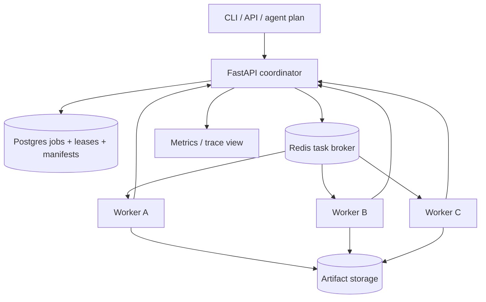

# QuantGrid — Distributed Quant Research Scheduler

> **Project blueprint / implementation specification** — this repository folder contains planning documents, **not a finished application**. The implementation prompt is in [BUILD_PROMPT.md](./BUILD_PROMPT.md).

**One-line pitch:** A fault-tolerant service that executes and tracks large batches of reproducible backtests using bounded distributed workers and an optional AI experiment planner.

| Attribute | Value |
|---|---|
| Level | Advanced |
| Approximate effort | 4–6 weeks |
| Previous-project relationship | Optional backtester adapter; standalone synthetic research workloads by default. New Python planning agent. |
| Recruiting signal | Distributed systems, state machines, idempotency, scheduling, performance scaling and reproducible compute infrastructure. |
| Mode | Offline research / synthetic or licensed data; never live trade execution |

## 1. Problem and outcome

A fault-tolerant service that executes and tracks large batches of reproducible backtests using bounded distributed workers and an optional AI experiment planner. This is an **engineering portfolio project**, not an alpha/profitability promise. The outcome is a demonstrable system with tests, evidence and realistic measurements.

### User stories
- Create bounded parameter-sweep jobs and track every child task.
- Run experiments across 1/2/4 workers and quantify parallel efficiency.
- Kill a worker while executing and recover missing tasks without double-counting artifacts.
- Recreate an older experiment from exact code, data and dependency manifest.

## 2. MVP features and limits

**MVP must include:** validated request/experiment contracts; deterministic domain engine; persistent outcomes; one failure path; one meaningful AI integration; automated correctness tests; reproducible demo and performance report.

**Explicit non-goals:** live brokerage connectivity, real-money automated execution, proprietary market data scraping, unbounded LLM-generated code execution, high-frequency profitability claims, premature Kubernetes deployment.

## 3. Technology stack
- Python FastAPI + Pydantic, PostgreSQL + SQLAlchemy/Alembic
- Redis + Celery for first version; Ray optional for benchmarked expansion
- DuckDB/Parquet and local/S3-compatible object storage for large outputs
- OpenTelemetry + Prometheus for per-job observability
- Fresh Python LLM planner limited to validated experiment specs

**Why this split:** deterministic back-end code owns numerical truth and state. An independently built AI layer supplies planning, retrieval or explanation only where needed. Use the simplest viable deployment for the MVP.

## 4. Architecture



### End-to-end processing
1. Validate parameter grid count, per-run memory/time budget, dataset signature and research protocol.
2. Expand to immutable child-task specs; compute spec_hash for idempotency and potential caching.
3. Maintain task state transitions PENDING→RUNNING→SUCCEEDED, RUNNING→RETRY_PENDING/FAILED, and explicit CANCELED.
4. Workers heartbeat and publish artifacts via temp file + atomic rename / staged object commit.
5. Coordinator reconciles stale leases; retries at-least-once execution but finalizes task once using unique task/output hashes.

## 5. API / CLI contract (proposed)

These endpoints/commands are the **interfaces to implement**, not claims that they already exist.

| Method | Path or command | Behavior |
|---|---|---|
| `POST` | `/v1/batches` | Submit bounded experiment batch with idempotency key |
| `GET` | `/v1/batches/{id}` | Progress counts, total cost and status |
| `GET` | `/v1/tasks/{id}` | Attempt log, worker and artifact IDs |
| `POST` | `/v1/batches/{id}/cancel` | Cooperative cancellation; report already-completed items |
| `POST` | `/v1/batches/{id}/retry-failed` | Retry eligible failed tasks |
| `GET` | `/v1/batches/{id}/results` | Merged metrics and result manifest |
| `POST` | `/v1/planner/specs` | Generate bounded typed experiment spec |

**Cross-cutting conventions:** response IDs are UUIDs; timestamps are UTC ISO-8601; pagination on list endpoints; explicit error types (`VALIDATION_ERROR`, `NOT_FOUND`, `RATE_LIMITED`, `WORKER_FAILURE`); request correlation ID; immutable completed results; `202 Accepted` for async execution.

## 6. Storage / data model (logical schema)

| Table / record | Essential fields |
|---|---|
| `batches` | id, user_id, dataset_sha, code_sha, spec_sha, submitted_at, state, quota |
| `tasks` | id, batch_id, spec_hash unique-per-batch, state, lease_owner, lease_expiry, attempts |
| `task_attempts` | task_id, attempt, worker, started_at, ended_at, status, error_code |
| `result_artifacts` | task_id unique, output_uri, output_sha, temp_uri, finalized_at |
| `worker_heartbeats` | worker_id, last_seen, resource_profile, inflight_count |

Use Alembic migrations for PostgreSQL projects. Store large arrays/time-series in Parquet or object storage, not a JSON database row. Record content hashes and immutable result references.

## 7. Domain algorithms and correctness requirements
- Every task uses exactly recorded input bars, immutable strategy config, train/test split, fee model, seed and result schema.
- Synthetic benchmark workload should include both short CPU-bound and long CPU-bound tasks; avoid comparing against IO-bound baselines only.
- Speedup = T1 / Tp and efficiency = speedup / workers; include overhead at low task counts.
- Retries cannot change a result silently; compare output checksum or mark numerical tolerance and stochastic sources.

## 8. AI / agent implementation — built fresh
- Planner proposes bounded JSON `ExperimentBatchSpec`, not arbitrary Python code.
- Quota and policy service validates total jobs, memory, worker time and allowed dataset refs before enqueue.
- Agent may read progress and explain failures; it cannot bypass quotas or change stored historical results.

**Architecture requirement:** do **not** reuse the earlier TypeScript agent, its Next.js UI, prompts or utilities. Create a new Python agent module with strict tool allowlists, structured inputs/outputs, provider adapter, explicit tool budget, traced execution and a deterministic mock provider.

## 9. Suggested repository layout

```text
07_quantgrid/
├── README.md                      # this implementation spec
├── BUILD_PROMPT.md                # paste into your coding assistant
├── pyproject.toml or CMakeLists.txt
├── docker-compose.yml             # only if services are required
├── .env.example                   # no committed secrets
├── src/ or apps/                  # API, workers, domain modules
├── tests/                         # unit, integration, adversarial tests
├── fixtures/                      # deterministic synthetic test data
├── scripts/                       # seed, run demo, inject failure, benchmark
├── docs/                          # ADRs, diagrams, correctness notes
└── benchmarks/                    # raw measurement outputs + methodology
```

Suggested implementation boundaries: `domain/` (pure algorithms), `storage/` (persistence), `api/` (request validation), `workers/` (async tasks where needed), `agents/` (fresh LLM orchestrator), `adapters/` (optional existing backtester), `observability/` (logs, metrics, tracing). For C++ MarketPulse, keep `engine/`, `include/`, `tests_cpp/`, and an independent `diagnostics/` Python application.

## 10. Build milestones
- [ ] Week 1: stand-alone deterministic backtest, task and batch schemas, single-worker happy path.
- [ ] Week 2: queue, workers, heartbeats, leases, cancellation, API and observability.
- [ ] Week 3: worker-kill testing, task idempotency, atomic result commit and reconciliation.
- [ ] Week 4: scaling benchmarks and bottleneck analysis.
- [ ] Weeks 5–6: new agent planner, cache behavior and polished demo/report.

## 11. Definition of done — acceptance checklist
- [ ] Submit 100+ synthetic tasks and generate one result per task ID with all manifest fields.
- [ ] Terminate worker mid-job: remaining tasks eventually settle without duplicate published results.
- [ ] Re-submit same batch idempotency key: no duplicate logical batch.
- [ ] Report measured T1, T2 and T4 on same dataset and hardware with worker allocation noted.

## 12. Testing strategy

1. **Unit:** pure math/state transitions, Pydantic validation, malformed timestamps, missing data and edge cases.
2. **Integration:** actual DB/queue where relevant; APIs, transactional effects, job lifecycle, artifact checksums.
3. **Adversarial:** bad agent tool arguments, injected document text, unsupported fields, duplicated requests and timeouts.
4. **Property/differential:** compare against a deliberately slow reference implementation or seeded known-good fixtures where appropriate.
5. **Failure injection:** stop a worker/consumer, corrupt one input, or force a tool timeout; assert controlled recovery.
6. **Reproducibility:** execute the same manifest twice and compare artifacts and outputs within documented tolerance.

## 13. Benchmarks and evaluation
- Tasks/min and queue wait p95 by worker count
- Speedup, parallel efficiency and scheduler overhead
- Recovery latency under worker loss and retry count distribution
- CPU/RAM consumption and artifact writes

**Benchmark report template:** Git SHA, OS/kernel, CPU model, RAM, dataset record count/hash, concurrency, warmup, repetitions, release/debug build, p50/p95/p99, raw CSV output, and explanation of measurement bias. Do not prefill results.

## 14. Security, risk and integrity
- Exactly-once execution is not generally achievable with ordinary task queues; provide at-least-once execution with idempotent *effects*.
- Big frameworks obscure the fundamentals; start Celery and evolve only if profiling identifies needs.

## Shared engineering standards (apply to this repository)

- **Standalone build:** create new Python agent orchestration for this project; **do not copy or depend on the existing TypeScript agent**. Integration with the existing *Python statistical-arbitrage backtester* is optional and must happen behind a documented adapter. Provide a local deterministic fallback so this repository runs on its own.
- **No live trading:** all market interactions are simulated, backtested or replayed. There are no broker/exchange order-placement credentials or endpoints.
- **Determinism before AI:** risk rules, calculations, test verdicts and job outcomes are produced by typed code, not LLM opinions. Use a `FakeLLM`/recorded-response implementation so tests and demos work without a paid API key.
- **Data boundaries:** use openly licensed data where permitted or reproducible synthetic data (clearly marked synthetic). Document data provenance, timezone (UTC), adjustments, missing bars, survivorship assumptions and licensing. Never imply simulated alpha is real profitability.
- **Reproducibility:** persist dataset checksum, code commit, config hash, environment/dependency lock, random seed, time split boundaries and artifact checksums for every meaningful run.
- **Operational hygiene:** structured JSON logs, request/job correlation IDs, bounded concurrency, timeouts, retries only for safe/idempotent operations, secrets via environment variables, migrations, health endpoints and graceful shutdown.
- **Quality gate:** type checking, linting, unit tests, integration tests, one negative/fault-injection test and a reproducible benchmark script. Report **measured** numbers with CPU/OS/workload details; never insert invented throughput or latency claims.
- **API security:** validate inputs with typed schemas; limit payloads, rate and resource consumption. Tool execution is restricted to an allowlist. External/LLM text is untrusted, and high-impact operations require human authorization.
- **Honest scope:** local Docker Compose first, documented production hardening later. Avoid Kubernetes, microservices and multi-agent complexity unless the specific project needs them.


## 15. Demo walkthrough

Launch a 144-job synthetic parameter grid, watch 4 workers process it, kill one worker, show recovery and finish with a reproducibility and speedup report.

**README screenshot/demo requirements once built:** one architecture diagram, one terminal/API demo showing real response payloads, one failure handling demonstration, one benchmark graphic and one limitations section.

## 16. Quant recruiter interview talking points

- Explain why the numerical engine is independent of any AI-generated narrative.
- Explain one correctness invariant, one failure mode and one resource/performance trade-off.
- Walk through a recorded experiment, its checksum/provenance and the test that could falsify its result.
- Discuss what would need to change before production use, without pretending this is an institutional trading system.

## 17. Sources and learning references

- [FastAPI](https://fastapi.tiangolo.com/)
- [PostgreSQL](https://www.postgresql.org/docs/)
- [OpenTelemetry Python](https://opentelemetry.io/docs/languages/python/)
- [Redis Streams](https://redis.io/docs/latest/develop/data-types/streams/)
- [Ray tasks](https://docs.ray.io/en/latest/ray-core/tasks.html) (optional distributed extension)
- [pytest](https://docs.pytest.org/)

### Start implementing

Copy the full prompt in **[BUILD_PROMPT.md](./BUILD_PROMPT.md)** into your chosen coding assistant from an empty new repository. The prompt instructs it to construct the system in ordered phases, run tests and report only verified results.
