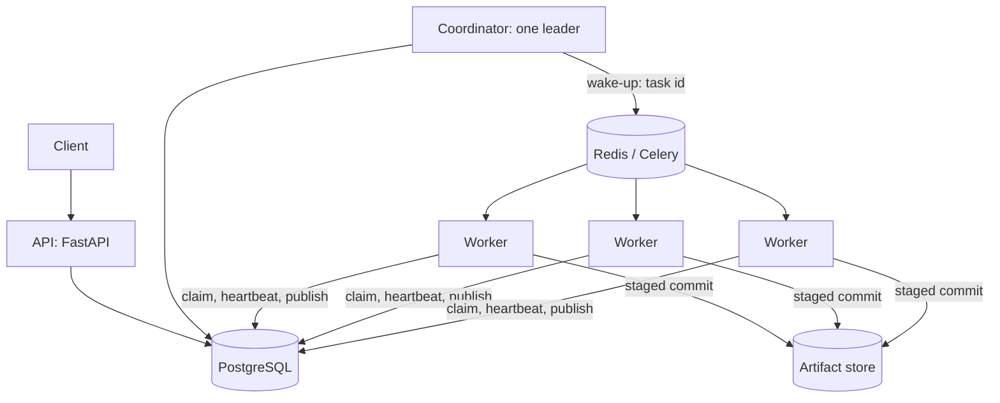

# Architecture

## Components



| Component | Responsibility |
| --- | --- |
| API | Validates requests, runs the quota policy, stores batches and tasks, serves progress and results. Holds no scheduler state. |
| Coordinator | Reclaims expired leases, tops up a bounded window of wake-up messages, derives batch state from task counts. One leader at a time (PostgreSQL advisory lock); standbys take over if it dies. |
| Worker | One process, one execution slot. Claims a task, runs the engine, commits the artifact, publishes the result. A heartbeat thread extends its leases. |
| PostgreSQL | The only source of truth: batches, tasks, attempts, leases, results, audit log. |
| Redis / Celery | Transport for wake-up messages. A message carries only a task id, so a lost or duplicated message cannot corrupt anything. |
| Artifact store | Content-addressed Parquet files on a local filesystem. |

## Task lifecycle

```
PENDING --claim--> RUNNING --publish--> SUCCEEDED
   |                 |-- error or lease expiry, attempts left --> RETRY_PENDING --claim--> RUNNING
   |                 `-- permanent error or no attempts left ---> FAILED --retry-failed--> RETRY_PENDING
   `---cancel--------`--------------------cancel----------------> CANCELED
```

`SUCCEEDED` and `CANCELED` are final. The same transition table lives in `domain/states.py` and in a PostgreSQL trigger; a test asserts the two are identical.

Batch state is derived from task counts: `ACCEPTED`, `RUNNING`, `CANCELING`, `COMPLETED`, `COMPLETED_WITH_FAILURES`, `CANCELED`.

## Submit

1. The API validates the body against `ExperimentBatchSpec` (unknown fields rejected).
2. The policy service checks quotas and the research protocol (see below), then the grid is expanded deterministically into immutable task specs. Each task gets a `spec_hash`, the SHA-256 of its canonical JSON.
3. One transaction inserts the batch and all its tasks. `UNIQUE(user_id, idempotency_key)` makes a repeated submission return the original batch.

## Execute

1. The coordinator marks eligible tasks as enqueued (`FOR NO KEY UPDATE SKIP LOCKED`, up to the dispatch window) and sends one message per task.
2. A worker claims the task with a conditional `UPDATE` that sets `RUNNING`, a lease expiry from the database clock, and increments `attempts`. Exactly one concurrent claim wins. Anyone else drops the message.
3. The worker re-validates the stored spec, checks the result cache (same `spec_hash`, `code_sha` and `env_sha`), loads and verifies the dataset, and runs the engine.
4. It encodes the result as Parquet, writes it to a temporary file, fsyncs, and renames it to `sha256/<aa>/<sha>.parquet` without overwriting.
5. It publishes: in one transaction that holds the task row lock it inserts the single `result_artifacts` row and sets `SUCCEEDED`. The transaction checks that the task is still `RUNNING` for this worker and attempt number.

## Failure handling

- **Worker killed or frozen.** Its lease expires. The reconciler closes the attempt as `LEASE_EXPIRED` and moves the task to `RETRY_PENDING` (or `FAILED` when attempts are exhausted). If the frozen worker resumes, its publish is rejected by the attempt check, and its output checksum is stored for comparison.
- **Task error.** Retryable errors go to `RETRY_PENDING` with exponential backoff up to `max_attempts`. Permanent errors (`DATA_INTEGRITY_ERROR`, `SPEC_ERROR`, `RESOURCE_LIMIT`, `PERMANENT_TASK_ERROR`) go straight to `FAILED`.
- **Lost wake-up message.** A task that stays unclaimed for `QG_DISPATCH_LOST_AFTER_S` is dispatched again.
- **Cancel.** Waiting tasks become `CANCELED` at once. Running tasks get a flag that the worker sees on its next heartbeat or at publish time. Results already published are kept and reported.
- **Coordinator dies.** A standby acquires the advisory lock. No state lives in the coordinator process.

Delivery is at-least-once. The published effect is at-most-once and exactly-once for every task that succeeds. See [correctness.md](correctness.md).

## Policy

`PolicyService` runs on every submission, including specs proposed by the AI planner. It checks: strategy and dataset allow-lists, dataset signature, task count, per-task runtime and memory against quota, worker-seconds for the whole batch, attempts, bootstrap samples, active batches per user, fault injection, and research-protocol rules (minimum train and test bars, test segment at least twice the longest lookback, split timestamps inside the dataset range).

## Reproducibility

Every batch stores a manifest: `code_sha` (hash of all package source), git commit and dirty flag, interpreter, platform, installed package versions (`env_sha`), `uv.lock` hash, and the dataset record. Each attempt stores the worker's `code_sha` and `env_sha`. A task spec contains everything that affects the result: dataset name and checksum, strategy and version, parameters, split, fee model, seed, workload and result schema version.

Datasets are recorded: each has a pinned SHA-256 over its logical content, recomputed on every load. See [datasets.md](datasets.md).

Artifacts hold only spec-derived metadata (no task id, no timestamps), so identical specs produce byte-identical files. `quantgrid verify BATCH --recompute N` re-runs N tasks and compares bytes. Bitwise equality holds for the same code, dependencies and CPU architecture; on other machines results should be compared within a tolerance.

## Data model

| Table | Purpose |
| --- | --- |
| `batches` | Spec, manifest, quota snapshot, state, idempotency key |
| `tasks` | Immutable spec and hash, state, lease owner and expiry, attempt counter |
| `task_attempts` | One row per attempt: worker, status, error, timings, output checksum |
| `result_artifacts` | One row per published result (`task_id` unique): URI, SHA-256, metrics |
| `worker_heartbeats` | Last seen, in-flight count, resource profile |
| `task_transitions` | Append-only audit log written by a trigger |

Large arrays live in Parquet files, not in rows.

## AI planner

`POST /v1/planner/specs` runs a bounded agent loop (step limit, tool-call limit, wall-clock timeout). It has seven read-only tools: list datasets, dataset info, list strategies, strategy schema, quota, cost estimate, dry-run validation. The final answer must contain one JSON object that parses as a strict `ExperimentBatchSpec` and passes `PolicyService`. The endpoint never stores or enqueues anything. The default provider is deterministic and local; a Claude provider is enabled only through environment variables. The explainer reads batch progress through a read-only interface and has no write path.

## Decisions

The reasoning behind the main design choices is in [adr/](adr).
